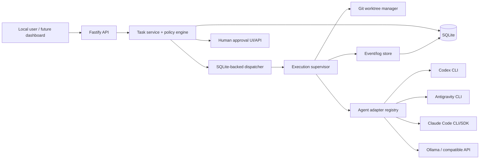

# Architecture: Personal Multi-Agent Orchestration System

**Status:** Research proposal; no implementation started  
**Reviewed:** 2026-11-19

## Purpose and principles

Build a local Windows service that accepts a task, selects a capable execution adapter, creates an isolated Git worktree, records progress and artifacts, and presents a reviewable result. Coordinate documented command-line or API interfaces. A desktop app is not an automation API: the installed Antigravity IDE can remain useful for manual work, while its documented CLI is the automation candidate once installed and verified.

- Provider-neutral task model and adapter boundary; preserve provider-specific features as optional capabilities.
- Durable state in local SQLite; execution can resume after service restart.
- Each worker gets a dedicated branch/worktree and bounded process sandbox. No worker receives push credentials or permission to merge/deploy.
- Treat model output, tool calls, repository files, and logs as untrusted input.
- Human review is mandatory before accepting changes; deployment is outside v1 and separately approved.
- Start with one local user and one service process. Add dashboard and remote access only after the local control plane is secure.

## Proposed components



A modular monolith is sufficient initially: Fastify routes, application services, SQLite repository, queue/worker loop, process supervisor, Git worktree manager, and adapters in one TypeScript codebase. Keep boundaries strict so the worker can later become a separate process. No Redis, Kubernetes, broker, or hosted control plane is needed for one workstation.

### Core modules

- **Task API:** create/read/cancel/retry tasks, request approvals, inspect events and artifacts.
- **Router:** capability and policy filtering first; weighted preferences second. Never route only by provider name.
- **Dispatcher/supervisor:** concurrency limits, heartbeat, timeout, cancellation, stdout/stderr capture, exit status, retries.
- **Worktree manager:** create a task branch from a selected commit, check repository identity, collect diff/status, and clean up only after retention permits.
- **Adapter registry:** identifies installed/authenticated agents and supports input/output modes, resumability, cancellation, file-edit behavior, and permission controls.
- **Review service:** separate review attempt on a read-only snapshot; records findings without changing implementation worktree.
- **Audit/event store:** append-only task events and structured runs; redact secrets before persistence.

## Agent adapter interface

The adapter contract is transport-neutral and capability-declared; it does not pretend every provider exposes identical control.

```ts
interface AgentAdapter {
  id: string;
  discover(): Promise<AgentAvailability>;
  capabilities(): AgentCapabilities;
  start(request: AgentRunRequest, signal: AbortSignal): Promise<AgentRunHandle>;
  stream(handle: AgentRunHandle, signal: AbortSignal): AsyncIterable<AgentEvent>;
  cancel?(handle: AgentRunHandle): Promise<void>;
  resume?(providerRunId: string, signal: AbortSignal): Promise<AgentRunHandle>;
  normalizeResult(handle: AgentRunHandle): Promise<AgentResult>;
}

type AgentCapabilities = {
  modes: Array<'agentic-cli' | 'sdk' | 'inference-api' | 'manual'>;
  structuredEvents: boolean; editsWorkspace: boolean; resumable: boolean;
  cancellable: boolean; permissionModes: string[];
  supportsModelSelection: boolean; supportsLocalInference: boolean;
};

type AgentRunRequest = {
  taskId: string; worktreePath: string; prompt: string; model?: string;
  timeoutMs: number; maxTurns?: number; permissionProfile: PermissionProfile;
  environment: Record<string, string>;
};

type AgentEvent =
  | { type: 'started' | 'heartbeat' | 'completed' | 'failed' | 'cancelled'; at: string }
  | { type: 'message'; at: string; text: string }
  | { type: 'tool'; at: string; name: string; status: string; summary?: string }
  | { type: 'approval-required'; at: string; action: string; detail: unknown }
  | { type: 'usage'; at: string; inputTokens?: number; outputTokens?: number; cost?: number }
  | { type: 'diagnostic'; at: string; code?: string; message: string };

type AgentResult = {
  status: 'succeeded' | 'failed' | 'cancelled' | 'needs-human';
  summary: string; providerRunId?: string; exitCode?: number;
  usage?: { inputTokens?: number; outputTokens?: number; estimatedCost?: number };
  artifacts: Array<{ kind: string; path?: string; content?: string }>;
  rawResultRef?: string;
};
```

`discover()` reports presence, version, safely detectable auth readiness, and blockers without reading/emitting credential material. Use native process spawning with argument arrays (never concatenate untrusted text into a shell command), known working directory, allowlisted environment, explicit timeouts, separate stdout/stderr. Parse versioned provider streams; store raw output only when needed and redact it. Manual tools create a user-input state rather than simulating clicks or keyboard input.

For Ollama and similar local inference APIs, distinguish a **model endpoint** from a **coding agent**. A raw chat endpoint cannot safely inspect/edit files or run tests by itself. Initially use it for review/planning/summarization unless wrapped by a separately permissioned harness.

## Task lifecycle

```text
queued -> validating -> waiting_for_agent -> preparing_worktree -> running
  -> collecting_result -> reviewing -> awaiting_human_review
  -> approved -> merge_ready -> merged (human action; later phase)

Any active state -> cancelling -> cancelled
running/validating/preparing -> retry_wait -> queued (within retry budget)
Any nonterminal state -> needs_human | failed
```

Each transition writes task state and an event transactionally. Define idempotency keys for submission and worker acquisition. On startup mark orphaned runs `interrupted`, reconcile process IDs/worktrees, then offer bounded retry or human recovery; never silently relaunch a possibly non-idempotent action. Cancellation kills the process tree and records cleanup status. Retry only transient availability/network errors with exponential backoff and jitter, capped per task/provider. Do not retry policy denials, bad input, human rejection, or uncertain partial operations.

Task record: ID, prompt, repository/root identity, base commit, priority, routing constraints, state, timestamps, attempt/retry counts, adapter/model, worktree/branch, run IDs, review outcome, approval identity/timestamps, artifacts, sanitized failure details. Keep secrets out of task payloads and logs.

## Routing and review

Filter adapters by availability, task class, required tools, requested provider/model, permission compatibility, budget ceiling, and local/cloud policy. Score the rest by task fit, observed success/latency, queue depth, cost class, and user preference. Explain the choice and allow override. Start with deterministic rules, not opaque model routing.

Review runs after implementation on a separate read-only snapshot. Reviewers get criteria, base commit, and patch; they do not share the writable worktree or secrets. Review is advisory and cannot approve its own patch. Require explicit human acceptance before merge. A future merge action must run from the trusted controller after approval, re-check base/head/diff and branch policy, and never grant an agent `git push` or production credentials.

## Boundaries and future UI

Bind Fastify to loopback in v1, enforce authentication, add CSRF/origin protections for browser mutations, and keep API unavailable from LAN by default. A dashboard can call the same API and consume events by SSE. Mobile access later should use a private VPN/tunnel or authenticated relay with short-lived scoped credentials; never expose a raw API port or agent shell publicly.

Provider remote-control features (for example Antigravity) are separate product capabilities, not this system’s API contract. Avoid undocumented GUI automation, window scraping, or credential/session extraction.

## Limits and open decisions

- CLI flags, JSONL schemas, auth, model availability, rate limits, and prices change. Pin/test adapter versions and revalidate upgrades.
- A CLI approval-bypass option may create broad authority; isolate at OS/container level instead of trusting prompts as a boundary.
- Windows-native process containment varies. Validate Windows Job Objects/AppContainer/WSL/container options before claiming strong isolation. Default to restricted identity and per-task directories, without host-wide credentials.
- Concurrent worktrees share Git object storage and may contend for CPU/RAM/disk. Cap concurrency and clean up safely.
- Local models avoid per-token hosted charges but require hardware, disk, power, and setup. Large coding models may exceed VRAM/RAM.
- Subscription access does not imply API access or API credits. Confirm entitlement and billing before enabling automated runs.

## Sources

- [Codex as a platform](https://developers.openai.com/blog/codex-as-a-platform)
- [Codex CLI reference](https://developers.openai.com/codex/cli)
- [Antigravity CLI headless mode](https://antigravity.google/docs/cli/headless/)
- [Claude Code CLI usage](https://docs.anthropic.com/en/docs/claude-code/cli-usage)
- [Git worktree documentation](https://git-scm.com/docs/git-worktree)
- [MCP specification](https://modelcontextprotocol.io/specification/2025-11-25)
